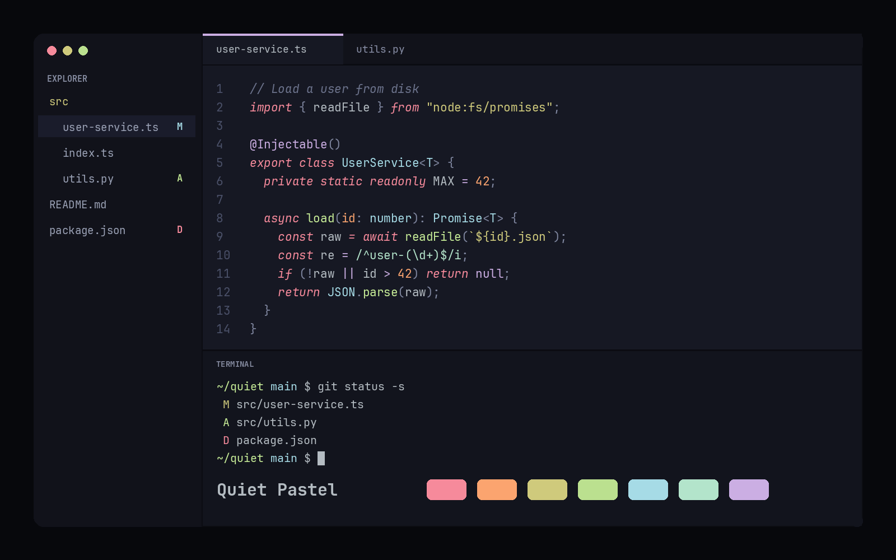

# Quiet Pastel

A dark, pale blue-violet theme: an app theme (interface and code colors) and a matching terminal theme. It uses soft, muted pastel accents on a cool background.

The image is an illustrative preview, not a screenshot.

## Inspiration

Quiet Pastel is inspired by the Monokai family of themes, especially the Octagon variant of Monokai Pro. The palette is original: no color values, theme files or code were copied from Monokai or Monokai Pro. This plugin is not affiliated with or endorsed by Monokai or its authors.

## Use it

1. Install **Quiet Pastel** from **Settings → Plugins**.
2. In **Settings → Appearance**, choose **Quiet Pastel** as the dark theme.
3. In **Settings → Terminal**, choose **Quiet Pastel Terminal**.

To try a local copy, open **Settings → Plugins → Development folders…** and add this folder.

## Palette

| Role | Hex |
| --- | --- |
| Editor background | `#161823` |
| Sidebar and tabs | `#11121a` |
| Text | `#b4bcc2` |
| Accent | `#cbaee3` |
| Operators | `#cbaee3` |
| Links | `#aab8f2` |
| Types | `#a6dbe6` |
| Pink and red | `#f68a9b` |
| Orange | `#fba46f` |
| Yellow | `#cfca7c` |
| Functions | `#c8ee98` |
| Git added | `#bbe08f` |
| Aqua | `#b3e4cb` |

## License

MIT. See [LICENSE](LICENSE).
